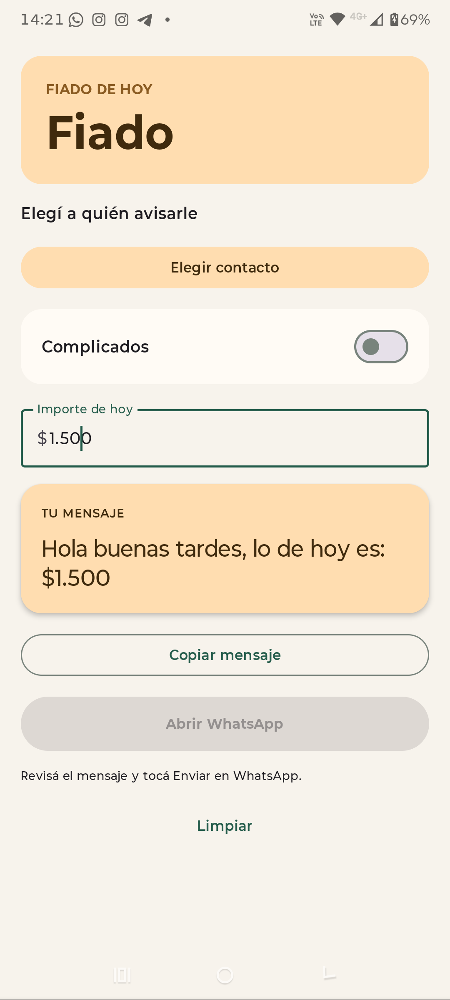
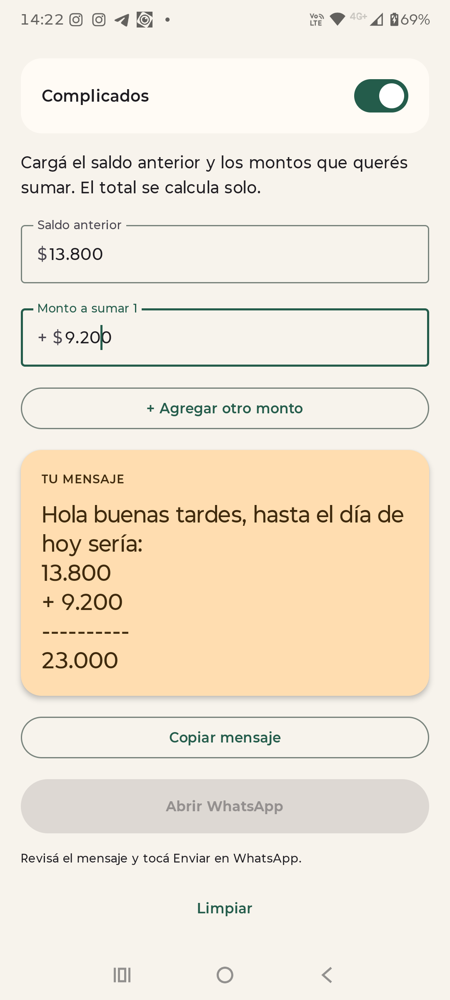

# Fiado

### Del importe al mensaje, en unos pocos toques.

Sacá una foto de la cuenta, elegí el contacto y abrí WhatsApp con el detalle y el total listos.

[**📲 Descargar la versión manual publicada (0.2.1)**](https://github.com/DiegoMiotti/fiado-app/releases/download/v0.2.1/Fiado-0.2.1-debug.apk)

Esta rama, `codex/fiado-candidata-oficial`, reúne el flujo automático de IA/OCR y el nuevo diseño Material 3 en **Fiado 0.3.0-rc1**. Es la base candidata para la próxima versión y futuras funcionalidades. Su APK se genera desde el código; el enlace de descarga corresponde a la versión manual anterior. [Versión candidata](docs/VERSION_CANDIDATA.md) · [Uso del flujo automático](docs/FLUJO_AUTOMATICO.md).

**Android 15 o superior · Pesos enteros · Sin crear una cuenta**

## Por qué hice Fiado

Creé Fiado para **aprender desarrollo Android y ayudar a mi padre con las cuentas de su negocio**. Él anota los fiados en un papel y después envía los importes a cada cliente por WhatsApp.

Elegí simplificar ese método que ya conoce: cargar los montos, calcular el total y preparar el mensaje. Así conserva sus anotaciones y ahorra mucho tiempo al comunicar los cobros. **Aprender resolviendo una necesidad real de mi familia es el motivo de esta app.**

## Así se ve

| Cobro de hoy | Mensaje listo |
|:---:|:---:|
|  |  |

Capturas reales con importes ficticios, sin nombres ni teléfonos.

## Cómo funciona

En esta variante los montos se leen automáticamente de la foto. Si la IA se equivoca, **Corregir lectura** permite remendar la cuenta; si la consulta falla, también se puede completar mirando la foto. El mensaje usa siempre el formato detallado de Complicados, con cargos que suman y pagos que restan. [Configuración y uso](docs/FLUJO_AUTOMATICO.md).

1. **Sacá una foto** o elegí una guardada: la cuenta se lee automáticamente.
2. **Elegí el contacto** y comprobá la foto, los movimientos y el mensaje listo.
3. **Confirmá y abrí WhatsApp.** Comprobás el destinatario y confirmás el envío allí.

La normalización de teléfonos está orientada a **celulares del área 11 de Argentina**. Fiado no envía mensajes automáticamente ni guarda un historial de deudas: tus anotaciones siguen siendo el registro.

## Instalación

Descargá el APK, abrilo en tu teléfono y permití la instalación desde la app utilizada si Android lo solicita. Es una **versión de prueba**, fuera de Google Play.

Hecha con **Kotlin y Jetpack Compose**. [Guía de desarrollo](docs/DESARROLLO.md) · [Validación y pendientes](VALIDACION.md) · [Notas de la versión](https://github.com/DiegoMiotti/fiado-app/releases/tag/v0.2.1) · [Reportar un problema](https://github.com/DiegoMiotti/fiado-app/issues).
